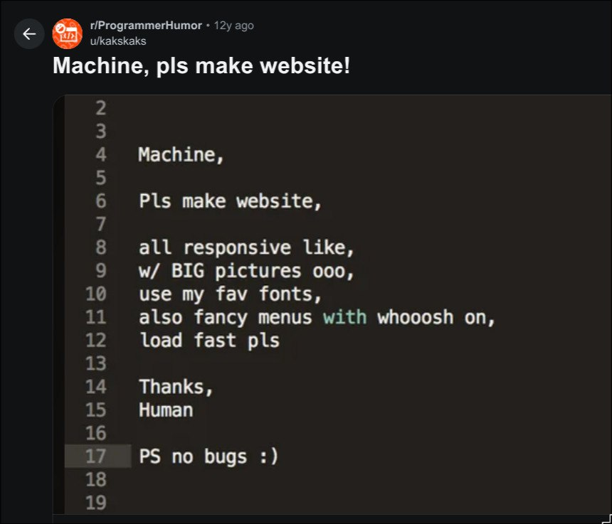
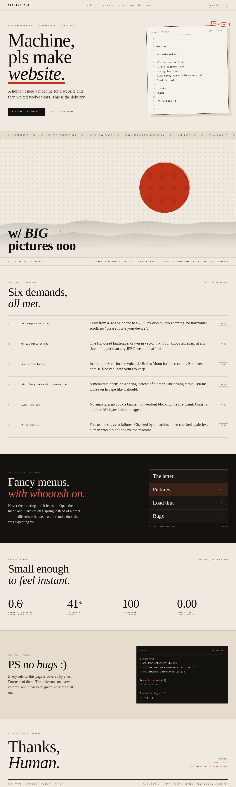
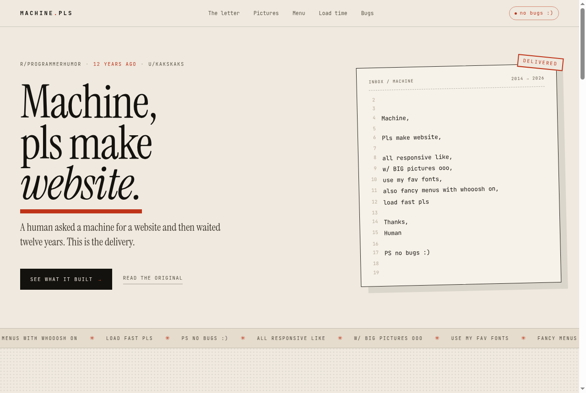
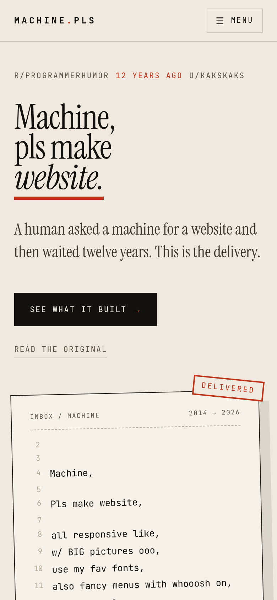

# machinepls

**https://machinepls.jeanmcm.workers.dev**

A single-page site built from a decade-old joke: someone asked a machine to make them a website, listed six demands, and signed off with "PS no bugs :)".



The post is real — [Machine, pls make website!](https://www.reddit.com/r/ProgrammerHumor/comments/2vk4ph/machine_pls_make_website/) by u/kakskaks in r/ProgrammerHumor, February 2015.

## What it is

The brief is the content. Every line of that letter became a requirement, and every requirement is answered with something you can check: a layout that holds from 390 to 1600 px, a 2.3 kB landscape drawn in vector ink instead of a hero photo, a menu that opens on a spring rather than a timer, and a footer that prints the real gzipped weight of its own JavaScript.

## How it was made

1. **Read the screenshot** and turned the six demands into a specification — one requirement per line, with a measurable acceptance criterion each.
2. **Designed it in [Doop](https://doop.dev)**, a local design canvas. The direction is carbon-copy print: warm paper, warm black ink, a single proofreader red, Instrument Serif speaking against JetBrains Mono. The letter is set as a rotated receipt with a `DELIVERED` stamp, and the "big pictures" demand is answered with a halftone vector landscape rather than stock photography.
3. **Implemented the approved frame in React**, one component per section, with the palette and type scale declared once in Tailwind's `@theme` block.
4. **Measured the claims.** Bundle size, LCP, CLS and the test count come from real runs and live in `src/lib/metrics.ts` — the page cannot drift from its own numbers.
5. **Published the static build to Cloudflare Workers** as an assets-only worker.

## Stack

- Vite+ (`vp`) · React 19 · TypeScript
- Tailwind CSS v4 with `@theme` tokens
- Motion — menu spring, scroll reveals, marquee, parallax, count-ups
- Instrument Serif + JetBrains Mono, self-hosted via `@fontsource`
- Vitest + React Testing Library — 14 behaviour tests
- Cloudflare Workers static assets, deployed with Wrangler
- Design: Doop

## Design

The page as designed, 1280 px wide and 4260 px tall.



## The published site



<p align="center"></p>

## Run it

```bash
pnpm install
pnpm dev      # local
pnpm build    # dist/
pnpm test     # 14 tests
pnpm deploy   # Cloudflare Workers (pnpm deploy:login first)
```

MIT
